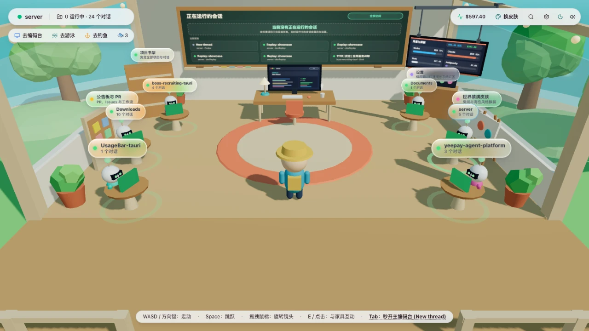
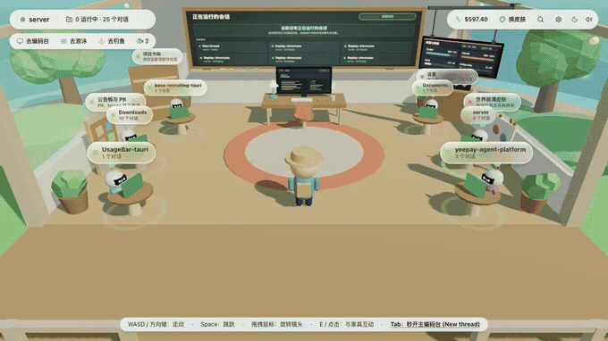
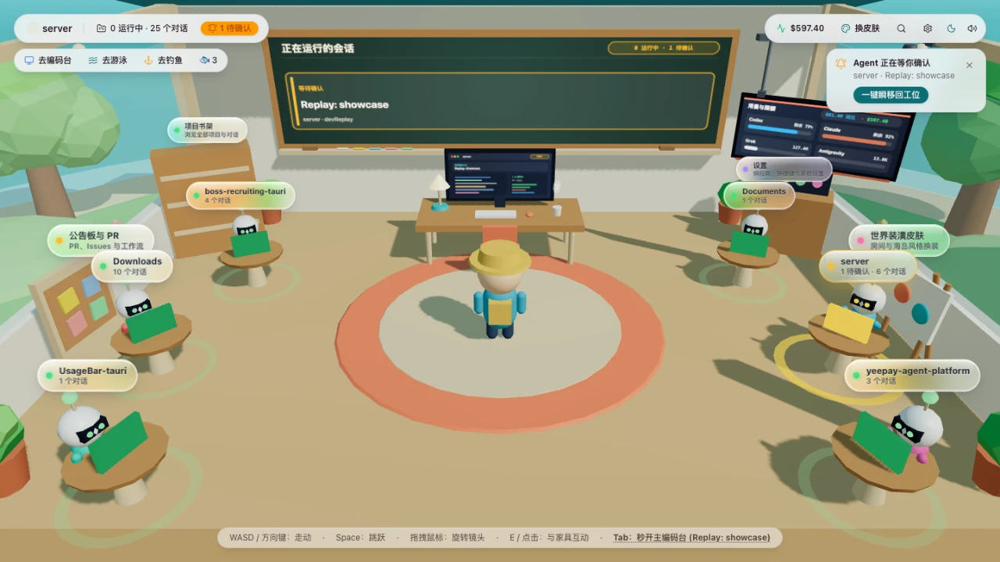
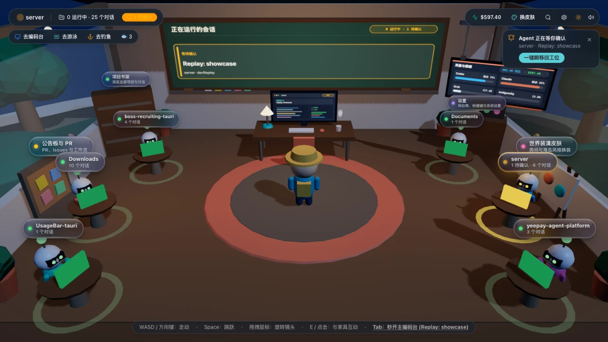
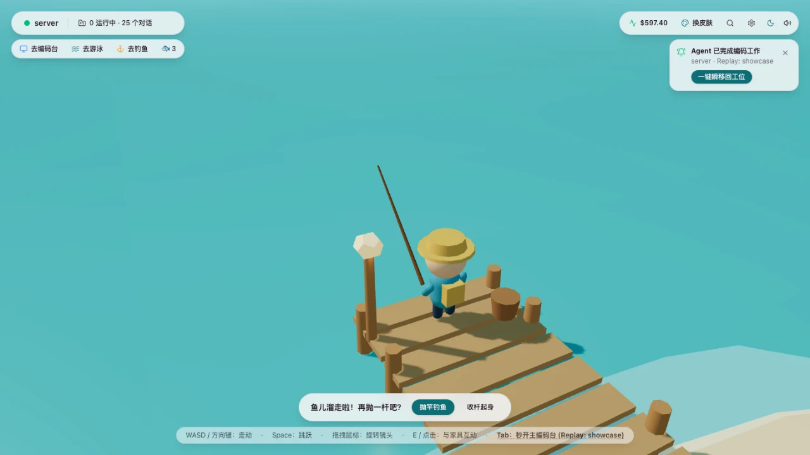

<p align="center">
  <a href="https://github.com/rayelzz/t3code-3d">
    
  </a>
</p>

<h1 align="center">T3 Code · 3D Island Edition</h1>

<p align="center">
  把你的 AI 编码 Agent 控制台变成一座可漫游、可钓鱼、可换装的 3D 海岛工作室。<br />
  An interactive 3D island coding world built on top of <a href="https://github.com/pingdotgg/t3code">T3 Code</a>.
</p>

<p align="center">
  <a href="#演示视频--demo-video"><strong>演示视频</strong></a> ·
  <a href="#实机截图--screenshots">实机截图</a> ·
  <a href="#3d-海岛核心特性">核心特性</a> ·
  <a href="#快速运行--quick-start">快速运行</a> ·
  <a href="https://github.com/rayelzz/t3code-3d/releases/tag/v0.1.0-3d-island">下载完整演示视频 (MP4)</a>
</p>

<p align="center">
  
</p>

## 演示视频 · Demo Video

> 点击下方动图可查看 / 下载 **720p 30fps 完整高清 MP4**（含行走与空格跳跃、皮肤换装、日夜切换、滑出式编码台、无边泳池游泳与海边栈桥钓鱼咬钩全流程）：
> [下载 / 播放完整高清视频 `t3code-3d-demo.mp4`](https://github.com/rayelzz/t3code-3d/releases/download/v0.1.0-3d-island/t3code-3d-demo.mp4)

<p align="center">
  <a href="https://github.com/rayelzz/t3code-3d/releases/download/v0.1.0-3d-island/t3code-3d-demo.mp4">
    
  </a>
</p>

## 实机截图 · Screenshots

<table>
  <tr>
    <td width="50%" align="center">
      
      <br />
      <sub><strong>阳光白天工作室</strong> · 液态玻璃项目标签、超大工作黑板与天花板垂吊用量牌</sub>
    </td>
    <td width="50%" align="center">
      
      <br />
      <sub><strong>实时会话黑板</strong> · 正在运行 / 待确认任务上墙展示，工位机器人高亮并一键瞬移回工位</sub>
    </td>
  </tr>
  <tr>
    <td width="50%" align="center">
      
      <br />
      <sub><strong>浪漫星夜模式</strong> · 暗黑液态玻璃折射质感、室内暖光与多套主题皮肤换装</sub>
    </td>
    <td width="50%" align="center">
      
      <br />
      <sub><strong>海边栈桥摸鱼</strong> · Agent 后台写代码时去泳池游泳或海边甩杆，完工即刻提醒</sub>
    </td>
  </tr>
</table>

## 3D 海岛核心特性

- **按项目排布的 3D 工位**：每个项目拥有专属工位与助手机器人，实时反映空闲、运行中与待确认状态，上方悬浮 **Apple 液态玻璃（Liquid Glass）** 质感标签，点击即可直达对应项目会话。
- **超大北墙实时黑板**：实时汇总当前正在 `running` / `waiting` 的会话卡片（空闲时展示最近活跃会话），支持点击黑板直接跳转活跃会话。
- **天花板垂吊双面用量牌**：办公室风格的吊顶双面看板，高分辨率实时呈现各模型供应商（Codex、Claude、Grok、Antigravity 等）7 日用量、剩余额度与预估消费，点击打开用量详情页。
- **自由漫游与物理互动**：支持 `WASD` / 方向键自由行走、`Space` 空格跳跃（带完整高度碰撞防穿模防卡住）、鼠标拖拽旋转镜头、`E` / 点击与室内外家具交互，以及 `Tab` 秒开滑出式主编码工作台。
- **装潢皮肤 & 昼夜氛围**：内置多套海岛与房间装潢主题（晨光海岛、京都樱花庭院、赛博霓虹等）及一键「阳光白天 / 浪漫星夜」切换，搭配环境音效。
- **海岛休闲摸鱼玩法**：Agent 在后台执行任务时，可以跳进无边泳池游泳、在海边栈桥甩杆钓鱼（带钓鱼图鉴记录），或在沙滩躺椅听海浪；当 Agent 需要审批或编码完成时，右上角浮卡即时提醒并支持「一键瞬移回工位」。
- **10 语种实时跟随切换**：完整接入 T3 Code 多语言系统（中文、English、日本語、한국어、Deutsch、Español、Français、Português、Русский、Svenska），切换设置语言后 3D 黑板、吊牌、液态玻璃标签与 HUD 实时同步更新。

### 快捷操作

| 按键 / 交互              | 功能                                                         |
| ------------------------ | ------------------------------------------------------------ |
| `W` `A` `S` `D` / 方向键 | 在工作室与海岛自由走动 / 泳池游泳                            |
| `Space`                  | 原地或移动中跳跃                                             |
| 鼠标左键拖拽             | 旋转 3D 视角镜头                                             |
| `E` 或点击家具 / 标签    | 与项目工位、黑板、用量吊牌、书架、公告板、泳池、钓鱼栈桥互动 |
| `Tab`                    | 秒开 / 收起滑出式主编码工作台                                |

## 快速运行 · Quick Start

本仓库基于 [T3 Code](https://github.com/pingdotgg/t3code) 构建，使用 Vite+ (`vp`) 管理依赖与开发服务：

```bash
git clone https://github.com/rayelzz/t3code-3d.git
cd t3code-3d
vp i
vp run dev
```

启动后在浏览器打开终端输出的地址（默认本地端口），即可进入 3D 海岛编码世界。如需体验无需 API Key 的模拟流式对话，可在工作台选择内置的 `Replay (dev)` 供应商。

---

## About Upstream T3 Code

T3 Code runs the coding agents on your machine and gives them one fast interface. Start a thread at your desk, then approve the next step from your phone.

It works with Claude Code, Codex, Cursor, OpenCode, Grok Build, Antigravity, Kiro, Pi, Muse Code, fx, and any [ACP](./docs/user/providers-acp.md) agent. If an agent is set up on your computer, T3 Code can control it.

- **Your subscriptions.** T3 Code does not resell tokens. It drives the agents you are already signed in to.
- **Every agent in one place.** Change models in the middle of a thread. Let Claude hand a task to Codex.
- **Desktop, web, and phone.** One server, and every client shows the same threads.
- **Remote ready.** Run agents on any machine. Connect over your local network, Tailscale, or [T3 Connect](./docs/user/remote-access.md).
- **Git built in.** Each thread can work in its own worktree. Review the diff, then commit, push, and open a pull request with one button.
- **Open.** MIT licensed.

### Documentation

- [Install and first run](./docs/user/install.md)
- [Remote access from a phone or another machine](./docs/user/remote-access.md)
- [Permission modes](./docs/user/permission-modes.md)
- [Source control](./docs/user/source-control.md)
- [Connect outside agents over MCP](./docs/user/outside-agents.md)
- [All docs](./docs/README.md)

## License

[MIT](./LICENSE)
